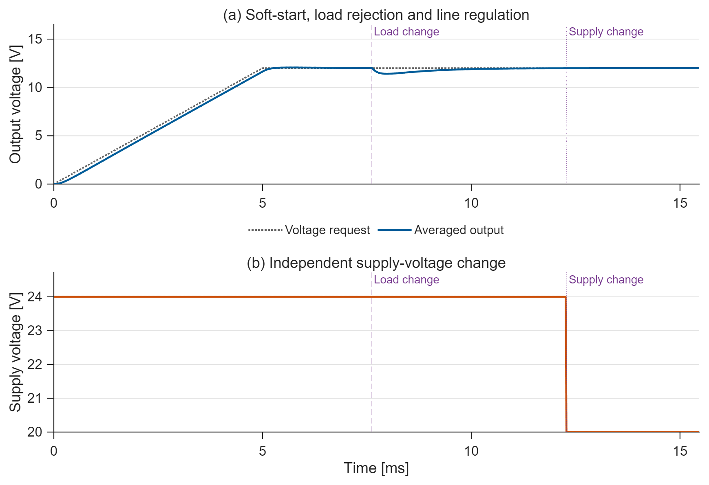
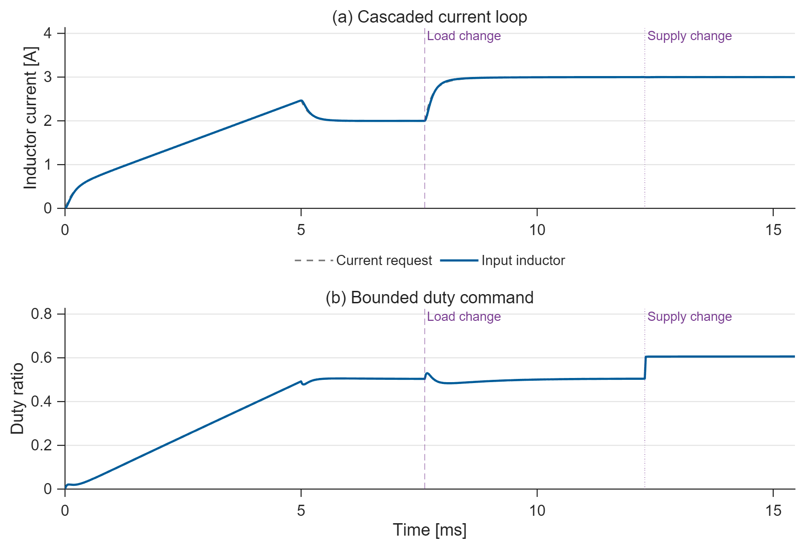
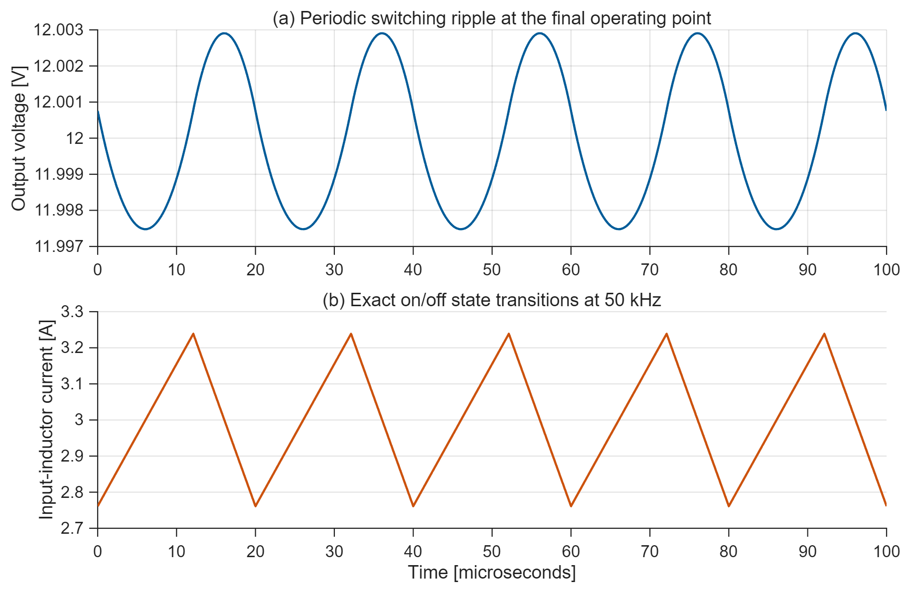

# Buck Converter Voltage Control

Cascaded voltage and current loops, supply feedforward, anti-windup, and
separate load and supply tests. The averaged model is checked against a
piecewise-exact 50 kHz PWM solution at the final operating point.

## Run

Requires **MATLAB and Simulink**. Verified on **R2025b**.
Open this folder and run `run_demo` or `run_demo(false)`.
Edit `project_parameters.m` to change the experiment.
The editable model is `buck_converter.slx`.

## Results

**Figure 1. Output regulation.** The reference ramps to 12 V.
After startup settles, the load changes from 6 to 4 ohms at
7.620 ms. The independent supply change from 24 to
20 V occurs at 12.280 ms, after load recovery.
The common endpoint is 15.460 ms.

**Figure 2. Controller action.** The voltage PI requests inductor current;
the faster current loop commands duty. Both PI states use back-calculation.
The current-request limit is 5 A and the maximum duty is 0.9.
The request limit is not an independent hardware peak-current protection circuit.

**Figure 3. Switching check.** Five periodic PWM cycles at the final supply
and load give 5.428 mV peak-to-peak output ripple.
The switching mean differs from the averaged DC balance by
0.000001%. This is a steady-state switching check;
Figures 1 and 2 are averaged transient results.

## Model and verification

`power_stage.m` contains the circuit equations; `voltage_controller.m` contains
the two PI loops. `operating_point.m` solves the lossy DC balance.
`switching_check.m` integrates each on/off state exactly with matrix exponentials
and solves the periodic initial condition directly.

The power stage uses ideal synchronous switching and 0.04 ohm winding resistance.
Dead time, capacitor ESR, semiconductor switching losses, and thermal behavior
are outside this model.
Before each later input change, every power-stage state and duty must settle.
Output voltage uses 2% of the reference; the other signals use 2% of their
phase excursion about the analytical DC equilibrium. The endpoint adds 10%
of the last recovery duration. Details are saved in `results/timing.json`.

`run_demo` checks the Simulink result against a separate piecewise ODE solve,
duty and current-request bounds, periodic PWM closure, continuous conduction at
the switching check point, and electrical power balance. The recorded maximum
ODE state error is 3.29e-09.

The model uses normal-mode Interpreted MATLAB Function blocks to keep equations
in short editable `.m` files. Code generation and hardware deployment are not included.
PNG previews, vector PDFs, CSV data, parameters, and metrics are in `results/`.

[MIT License](LICENSE).
